<<<<<<< HEAD
# Awesome-Laboratory-Automation-Robot-Pipetting-Systems

=======
<div align="center">



# 🔬 Awesome Laboratory Automation & Robot Pipetting Systems 🤖

**A community-curated directory of cloud workcell orchestration platforms, enterprise liquid handling software, and open-source Python robotics SDKs for high-throughput screening, assay execution, and autonomous "lab-in-the-loop" science.**

---

<!-- Badges Header -->
<p align="center">
  <a href="https://github.com/ishandutta2007/Awesome-Awesome-Awesome"></a><a href="https://discord.gg/jc4xtF58Ve"></a>
  <a href="https://github.com/ishandutta2007/Awesome-Laboratory-Automation-Robot-Pipetting-Systems/stargazers"></a>
  <a href="https://github.com/ishandutta2007/Awesome-Laboratory-Automation-Robot-Pipetting-Systems/network/members"></a>
  <a href="https://github.com/ishandutta2007/Awesome-Laboratory-Automation-Robot-Pipetting-Systems/issues"></a>
  <a href="LICENSE"></a>
  <a href="https://github.com/ishandutta2007/Awesome-Laboratory-Automation-Robot-Pipetting-Systems/pulls"></a>
  <a href="https://github.com/ishandutta2007"></a>
</p>

</div>

---

## 📑 Table of Contents
- [🌐 Sector Overview & Market Dynamics](#-sector-overview--market-dynamics)
- [🏢 Enterprise & SaaS Hosted Platforms](#-enterprise--saas-hosted-platforms)
- [🐍 Open-Source GitHub Projects](#-open-source-github-projects)
- [🧩 Building a Modern Open-Source Stack](#-building-a-modern-open-source-stack)
- [🤝 How to Contribute](#-how-to-contribute)
- [⭐ Star History](#-star-history)
- [💖 Support & Community](#-support--community)
- [⚠️ Disclaimer](#-disclaimer)

---

## 🌐 Sector Overview & Market Dynamics

The global **laboratory automation and robotic liquid handling market** is valued at approximately **$6.6 billion to $10.1 billion in 2026** and is projected to expand at a compound annual growth rate (**CAGR of 6.6%–9.4%**) toward **$14.5+ billion by 2030**, spurred by drug discovery acceleration, personalized genomics, and synthetic biology.

The market exhibits a **bimodal structural dynamic**:
- **Physical Hardware Tier (Moderately Concentrated):** Capital-intensive liquid handling robotics, plate sealers, and robotic gantries remain concentrated among incumbent industrial leaders (such as Tecan, Hamilton, Danaher/Beckman Coulter, and Thermo Fisher), who historically defended walled-garden automation ecosystems.
- **Software & Workcell Orchestration Tier (Highly Fragmented & Disrupted):** Workcell scheduling, data harmonization, and protocol design are experiencing rapid fragmentation. Cloud-native platforms (e.g., Automata, Benchling, TetraScience) and community-driven, hardware-agnostic Python frameworks (e.g., PyLabRobot) are unbundling legacy software, breaking vendor lock-in, and spearheading the shift toward AI-powered "lab-in-the-loop" self-driving laboratories.

---

## 🏢 Enterprise & SaaS Hosted Platforms

Below is a curated comparison of leading SaaS and enterprise software platforms for liquid handling orchestration, digital SOPs, and automated assay management. 

> *Table sorted in descending order by company scale (market valuation / annual revenue).*

| 🏢 Platform | 💰 Company Size (Valuation / Revenue) | 🎯 Core Focus & Capabilities | 💵 Pricing (Starting Tier) | 🎁 Free Tier / Free Trial Limits |
|:---|:---|:---|:---|:---|
| **[Benchling Automation](https://www.benchling.com/)** | **Valuation: $6.1B** (Series F) <br> *~$200M ARR* | Connects scientific data directly to automated execution. Features drag-and-drop Automation Designer, Python-in-Benchling scripts, and Bayesian experiment optimization across 200+ instruments. | **$15,000 / year** <br> *(Commercial Startup tier, includes up to 5 user seats; scales at ~$3,000/seat/yr)* | **Free Forever Tier for Academics** (includes core ELN, molecular biology suite, and 10 GB cloud storage); 14-day commercial trial on request. |
| **[Tecan FluentControl](https://www.tecan.com/)** | **Market Cap: $4.2B USD** *(SIX: TECN)* <br> *~$1.1B Annual Revenue* | Dedicated liquid handling software for Tecan Fluent workstations. Features 3D deck layout visualization, Identity Access Management (IAM), 21 CFR Part 11 security, and liquid class editors. | **$6,500 / year** <br> *(Base software runtime & driver license per workstation seat)* | **30-Day Evaluation Trial** with FluentControl 3D deck simulator and offline protocol compiler upon authorized partner registration. |
| **[Hamilton VENUS](https://www.hamiltoncompany.com/)** | **Est. Valuation: ~$3.0B** <br> *~$1.05B Annual Revenue (Private)* | Native control environment for Hamilton Microlab STAR, VANTAGE, and Nimbus platforms. Features CO-RE II pipette monitoring, deck configuration, and automated error-recovery routines. | **$5,500 base license** <br> *(One-time license + $1,200/year workstation maintenance contract)* | **30-Day Offline Simulation License** (full VENUS Simulator with virtual deck editor, step-through debugging, and mock run simulation). |
| **[TetraScience Tetra Data Platform](https://www.tetrascience.com/)** | **Valuation: $1.2B** (Series B Unicorn) <br> *~$80M+ Total Funding* | Scientific data cloud ingesting raw outputs from 1,000+ laboratory instruments. Harmonizes data into vendor-agnostic Intermediate Data Schema (IDS) and open Delta Lake for AI/ML pipelines. | **$25,000 / year** <br> *(Starter tier connecting up to 5 automated instrument data pipelines)* | **30-Day Proof-of-Concept Sandbox** supporting up to 3 instrument pipeline integrations and sample IDS data transformation models. |
| **[Opentrons Cloud & Protocol Designer](https://opentrons.com/)** | **Valuation: ~$500M** (Series C) <br> *~$200M+ Total Funding* | Cloud-connected accessible laboratory automation. Provides intuitive visual Protocol Designer, central robot fleet management, and direct integration with Benchling and Python runtimes. | **$49 / month per robot** <br> *(Opentrons Cloud/LabApp tier; $0 for local protocol execution software)* | **100% Free Forever Local Software** with unrestricted visual Protocol Designer, unlimited protocol exports, and full local Python API access. |
| **[Automata LINQ](https://www.automata.tech/)** | **Valuation: ~$320M** *(Series C led by Dimension & Danaher, 2026)* | Cloud-native "operating system for AI-ready labs." Features intelligent scheduling engine, drag-and-drop workflow canvas, and Python SDK to orchestrate multi-vendor robotic workcells. | **$18,000 / year** <br> *(Base orchestrator subscription per multi-instrument workcell)* | **14-Day Cloud Simulation Trial** with virtual digital twin access, workflow routing simulation, and API playground upon enterprise demo validation. |
| **[Biosero Green Button Go](https://biosero.com/)** | **Acquisition / Valuation: $165M** *(Acquired by BICO Group)* <br> *~$35M Annual Revenue* | Lab automation scheduling and orchestration suite with assistive AI for natural language workflow design, dynamic instrument routing, and 24/7 autonomous scheduling. | **$8,500 / year** <br> *(Green Button Go Scheduler runtime license per robotic instrument cluster)* | **30-Day Evaluation License** featuring GBG virtual instrument simulator, sample workcell layout editor, and assistive AI protocol builder upon certification. |
| **[HighRes Biosolutions Cellario OS](https://www.highres.com/)** | **Acquisition / Valuation: ~$120M** *(Axel Johnson Inc.)* <br> *~$50M Annual Revenue* | Web-based laboratory orchestration platform coordinating collaborative robots, mobile carts, manual bench steps, and shared analytical devices with clash detection and digital SOPs. | **$12,000 / year** <br> *(Base Cellario runtime license including standard instrument driver bundle)* | **30-Day Virtual Testbed Trial** (Cellario simulation suite with interactive digital SOP authoring and resource conflict detection). |
| **[Strateos Cloud Lab](https://www.strateos.com/)** | **Valuation / Funding: ~$105M** <br> *~$90M+ Total Capital Raised* | Cloud Lab Automation-as-a-Service enabling remote access to fully automated physical biology workcells in Menlo Park and San Diego via web UI, Autoprotocol JSON, and REST APIs. | **$2,500 / month** <br> *(Base platform subscription + transparent per-run consumables/instrument runtime fees)* | **14-Day Pilot Developer Account** including **$500 cloud execution credit** for protocol syntax dry-runs and automated workcell testing. |

---

## 🐍 Open-Source GitHub Projects

Open-source tooling enables vendor-agnostic control, eliminates prohibitive annual software licenses, and allows researchers to script reproducible multi-step protocols using clean Python.

> *List sorted in descending order by GitHub Stars_Count. Click any Stars_Badge to view stargazers.*

1. **[PyLabRobot](https://github.com/PyLabRobot/pylabrobot)** [](https://github.com/PyLabRobot/pylabrobot/stargazers)  
   **The universal, hardware-agnostic Python SDK for lab automation.** Provides a unified, high-level object-oriented interface for liquid handlers across Hamilton (STAR, Microlab Vantage), Tecan (Fluent, Freedom EVO), and Opentrons (OT-2). Includes digital deck visualization, volumetric liquid tracking, standard labware definitions, and pump/heater-shaker controls.

2. **[Opentrons Python API & Workstation Ecosystem](https://github.com/Opentrons/opentrons)** [](https://github.com/Opentrons/opentrons/stargazers)  
   **The foundational open-source protocol engine and workstation software** for Opentrons Flex and OT-2 liquid handling robots. Supports customizable tip pickup, temperature/magnetic/thermocycler modules, 1–96 channel pipettes, and custom labware definition generation.

3. **[pyhamilton](https://github.com/dgretton/pyhamilton)** [](https://github.com/dgretton/pyhamilton/stargazers)  
   **Direct Python interface for Hamilton liquid handling workstations.** Enables programmatic, scriptable control over Hamilton Microlab STAR, STARlet, and VANTAGE liquid handlers, bypassing the proprietary VENUS GUI for complex, dynamic, and feedback-driven assay routines.

4. **[Autoprotocol Python](https://github.com/autoprotocol/autoprotocol-python)** [](https://github.com/autoprotocol/autoprotocol-python/stargazers)  
   **Python library for generating Autoprotocol**, the standard JSON specification for formalizing liquid handling, pipetting, thermocycling, and automated biological experiments for cloud laboratories and robotics workcells.

5. **[OpenSDL](https://github.com/fl-sean03/OpenSDL)** [](https://github.com/fl-sean03/OpenSDL/stargazers)  
   **Modular Python foundation for reproducible computational and autonomous laboratories (Self-Driving Labs).** Connects robotics orchestration, simulation profiles, and closed-loop Bayesian optimization for experiment steering.

6. **[MADSci](https://github.com/AD-SDL/MADSci)** [](https://github.com/AD-SDL/MADSci/stargazers)  
   **Modular Autonomous Discovery for Science Framework.** Provides open-source distributed node communication, orchestrator microservices, and instrument driver abstractions for robotic laboratories.

7. **[Matterix](https://github.com/AccelerationConsortium/Matterix)** [](https://github.com/AccelerationConsortium/Matterix/stargazers)  
   **Digital Twin simulation environment for robotics-assisted chemistry and biology lab automation.** Built by the Acceleration Consortium to simulate physical robotic arms, dispensers, and plate transport prior to physical execution.

8. **[Plateo](https://github.com/Edinburgh-Genome-Foundry/Plateo)** [](https://github.com/Edinburgh-Genome-Foundry/Plateo/stargazers)  
   **Python biolab automation library** developed by Edinburgh Genome Foundry. Features picklist simulators, microplate parsers, volume tracking, and worklist generators for acoustic (Labcyte Echo) and tip-based liquid handlers.

9. **[orca](https://github.com/Cheshire-Labs/orca)** [](https://github.com/Cheshire-Labs/orca/stargazers)  
   **Lab automation scheduling software and workflow orchestrator.** Executes parallel lab workflows in pure Python across multi-vendor instruments without heavy enterprise overhead.

10. **[robotevo](https://github.com/qPCR4vir/robotevo)** [](https://github.com/qPCR4vir/robotevo/stargazers)  
    **Generates Freedom EVOware scripts** for the Freedom EVO universal pipetting robot from TECAN. Abstracts complex liquid classes and multi-channel dispensing.

11. **[automancer](https://github.com/adaptyvbio/automancer)** [](https://github.com/adaptyvbio/automancer/stargazers)  
    **Open-source experiment automation application** created by Adaptyv Bio. Enables researchers to visually design, schedule, and execute automated multi-instrument assay protocols.

12. **[robotools](https://github.com/JuBiotech/robotools)** [](https://github.com/JuBiotech/robotools/stargazers)  
    **Pythonic in-silico liquid handling and Tecan Freedom EVO worklist generator.** Translates high-level dilution and transfer logic into formatted .gwl files.

13. **[Roboliq](https://github.com/ellis/roboliq)** [](https://github.com/ellis/roboliq/stargazers)  
    **Declarative protocol automation engine for liquid handling robots.** Pioneered high-level semantic descriptions for plate layouts, liquid class calibration, and liquid volume calculations.

14. **[Otto_the_Robot](https://github.com/Luger-Lab/Otto_the_Robot)** [](https://github.com/Luger-Lab/Otto_the_Robot/stargazers)  
    **Validated Protocols for Pipetting with OpenTrons.** Academic repository of tested protocols, customized labware definitions, and liquid classes for structural biology, crystallization, and biophysics assays.

---

## 🧩 Building a Modern Open-Source Stack

By combining modular open-source components, researchers can construct a vendor-agnostic, self-hosted laboratory automation architecture:

```
┌─────────────────────────────────────────────────────────────┐
│                 Experiment Design & Optimization            │
│                 (OpenSDL / Bayesian Active Learning)        │
└──────────────────────────────┬──────────────────────────────┘
                               │
┌──────────────────────────────▼──────────────────────────────┐
│                Workflow Scheduling & Orchestration           │
│                    (orca / Automancer / MADSci)              │
└──────────────────────────────┬──────────────────────────────┘
                               │
┌──────────────────────────────▼──────────────────────────────┐
│                Unified Robot Control & Drivers               │
│         (PyLabRobot / pyhamilton / Opentrons Python API)     │
└──────────────────────────────┬──────────────────────────────┘
                               │
┌──────────────────────────────▼──────────────────────────────┐
│                 Liquid Handlers & Physical Deck              │
│        (Opentrons Flex/OT-2, Hamilton STAR, Tecan Fluent)   │
└─────────────────────────────────────────────────────────────┘
```

- **Execution Control:** Use [PyLabRobot](https://github.com/PyLabRobot/pylabrobot) as the unified abstraction layer across diverse pipetting hardware.
- **Instrument-Specific Logic:** Leverage [pyhamilton](https://github.com/dgretton/pyhamilton) for deep native Hamilton control or [Opentrons Python API](https://github.com/Opentrons/opentrons) for benchtop microplates.
- **Workflow Scheduling:** Use [orca](https://github.com/Cheshire-Labs/orca) to coordinate incubators, plate readers, centrifuges, and liquid handlers in parallel.
- **Standard Protocol Format:** Formalize protocol definitions with [Autoprotocol Python](https://github.com/autoprotocol/autoprotocol-python) for interoperability.

---

## 🤝 How to Contribute

Contributions are warmly welcomed! Help make laboratory automation and robotic pipetting tools accessible to researchers worldwide:

1. 🍴 **Fork the repository** on GitHub.
2. 🌿 **Create a new branch** (`git checkout -b feature/add-new-tool`).
3. ✍️ **Add or update an entry** following the table or list schema (include factual descriptions, starting price, free tier limit, and links).
4. 🧪 **Check formatting** to ensure Markdown rendering and badge links are valid.
5. 🚀 **Submit a Pull Request** with a clear explanation of why the tool belongs in this list.

For broader collections of curated software, explore [Awesome-Awesome-Awesome](https://github.com/ishandutta2007/Awesome-Awesome-Awesome).

---

## ⭐ Star History

[](https://star-history.dera.page/#ishandutta2007/Awesome-Laboratory-Automation-Robot-Pipetting-Systems&type=date&legend=top-left)

---

## 💖 Support & Community

Thank you for exploring and utilizing this curated directory! If you find this repository valuable for your research, lab setup, or biotech engineering workflows, please consider supporting the project:

- ⭐ **Star the repository** to boost discoverability and help other scientists find open automation tools.
- 🍴 **Fork the repo** to adapt it for your own research group, robotics workcell, or protocol library.
- 📢 **Share with peers** on LinkedIn, Twitter/X, Discord, or laboratory automation forums.
- ☕ **Sponsor the maintainer** — Buy a coffee or support ongoing maintenance via the [GitHub Sponsors Dashboard](https://github.com/sponsors/ishandutta2007).

Your support enables continuous updates, protocol verification, and new open-source tooling guides!

---

## ⚠️ Disclaimer

- This is an **independent, community-curated index** — listings are not commercial endorsements.
- Regulated laboratory environments must adhere to applicable regulatory frameworks (such as FDA **21 CFR Part 11** for electronic records and signatures, and **GxP** validation protocols).
- **Physical Validation Required:** All robotic liquid handling scripts, volumetric transfer calculations, and scheduling sequences must be thoroughly dry-run and validated with mock buffers prior to executing protocols with live biological specimens or hazardous chemical agents.

---

<div align="center">
  <sub>Maintained with ❤️ for the global scientific robotics and biotech automation community.</sub>
</div>
>>>>>>> edc74a597c057b8c952af20641909824c744e664
## Top Laboratory Automation & Robot Pipetting Systems Ecosystem


**Curated List of SaaS Products & Open-Source GitHub Projects**  

*Focused on Liquid Handling, Protocol Orchestration & Hardware-Agnostic Control*  

**Last updated: October 2026**


This repository tracks notable **SaaS platforms** and **open-source projects** for **Laboratory Automation & Robot Pipetting Systems**. These tools enable researchers to control high-throughput fluid assays via code scripts—writing Python protocols that orchestrate pipettes, thermocyclers, plate readers, and robotic arms with reproducibility and traceability.


**Examples** include Benchling, TetraScience, Automata, Opentrons, Biosero Green Button Go, HighRes Biosolutions, Strateos (Transcriptic), Hamilton VENUS, Tecan FluentControl, and Cellario (the category leaders).


**Open-source emphasis**: This section is heavily expanded with every major active project for self-hosting, hardware-agnostic control, and open protocol standards—ideal for lab engineers, researchers, and developers seeking transparent, vendor-independent automation.


Contributions welcome! Open a PR to add/update entries. Keep descriptions factual and link to official sites.


## Table of Contents

- [SaaS/Hosted Platforms](#saas-hosted-platforms)

- [Open-Source GitHub Projects](#open-source-github-projects)

- [How to Contribute](#how-to-contribute)

- [Disclaimer](#disclaimer)


## SaaS/Hosted Platforms


- **[Opentrons](https://opentrons.com/)**  

  Open-source lab automation with the **Python Protocol API** for Flex and OT-2 robots . Write lab protocols in Python that read like lab notebooks—specify labware, pipettes, modules, and the exact sequence of movements . Features **runtime parameters** (user-customizable variables without code changes), **robot motor control** (gantry, plunger, gripper), **liquid level detection**, **dynamic pipetting**, and **concurrent commands** for thermocyclers and heater-shakers . The **Opentrons App** runs protocols with simulation mode before physical execution .


- **[Benchling](https://www.benchling.com/)**  

  R&D cloud platform for biology with electronic lab notebook (ELN), LIMS, and protocol management. Features structured data capture, collaboration, and integration with lab automation.


- **[TetraScience](https://www.tetrascience.com/)**  

  Scientific data cloud connecting lab instruments to cloud data platforms. Features automated data collection, standardization, and integration with analytics tools.


- **[Automata](https://www.automata.tech/)**  

  Lab automation platform with robotic arms and software orchestration. Features flexible workflow automation for biology and chemistry labs.


- **[Biosero Green Button Go](https://www.biosero.com/)**  

  Lab automation scheduling software orchestrating multiple instruments. Features drag-and-drop workflow design, device integration, and plate scheduling.


- **[HighRes Biosolutions](https://www.highresbio.com/)**  

  Automated lab systems with robotic arms and scheduling software. Features modular automation for drug discovery and genomics.


- **[Strateos (Transcriptic)](https://strateos.com/)**  

  Robotic cloud laboratory for life sciences . Experiments specified in **Autoprotocol** (open JSON standard) and submitted via JSON:API REST API . Features remote experiment execution, dataset retrieval, and Python client library (TxPy) .


- **[Hamilton VENUS](https://www.hamiltoncompany.com/)**  

  Liquid handling robot control software. Features method programming, deck configuration, and integration with Hamilton STAR/Vantage systems.


- **[Tecan FluentControl](https://www.tecan.com/)**  

  Liquid handling robot control software for Tecan Freedom EVO and Fluent systems. Features method development, simulation, and device integration.


- **[Cellario](https://www.highresbio.com/cellario/)**  

  Laboratory automation scheduling software from HighRes Biosolutions. Orchestrates multiple instruments and robotic arms.


## Open-Source GitHub Projects


- **[Opentrons Python Protocol API](https://github.com/Opentrons/opentrons)**  

  **The most accessible open-source lab automation API** (Apache-2.0). Write Python protocols that control Flex and OT-2 robots, pipettes, thermocyclers, heater-shakers, and temperature modules . **Runtime parameters** allow user customization without code changes . **Robot motor control** commands move gantry, plunger, and gripper independently of labware . **Liquid level detection** targets meniscus during aspiration . **Concurrent commands** run thermocycler profiles while pipetting continues . Simulate with `opentrons_simulate protocol.py` before physical execution .


- **[PyLabRobot](https://github.com/PyLabRobot/pylabrobot)**  

  **The hardware-agnostic SDK for lab automation** (MIT). Control **Hamilton STAR, Tecan EVO, and Opentrons OT-2** through a single universal Python interface that works on Windows, macOS, Linux, and Raspberry Pi . **Swap backends without rewriting protocols**—same code runs on different robots . Features **async-first design**, **browser-based visualizer** for deck state during runs, **simulation backend** for protocol testing without hardware, and **resource management** (plates, tip racks, troughs) with automatic tip and volume tracking . **The most flexible open-source framework for multi-vendor lab automation.**


- **[Autoprotocol](https://github.com/autoprotocol/autoprotocol-python)**  

  **Open JSON standard for specifying biology experiments** (open-source) . Used by Strateos/Transcriptic cloud lab for remote experiment execution . Features declarative instructions for liquid handling, thermocycling, gel separation, and purification . **The most widely adopted open standard for lab protocol interoperability.**


- **[SiLA 2](https://sila-standard.com/)**  

  **Open standard for lab instrument communication** (open-source) . Enables **vendor-agnostic device integration**—combine new equipment with legacy instruments . Features **Feature Definition Language (FDL)** for specifying instrument capabilities, **Universal SiLA Client** for discovery without configuration, and **SiLA Installer** for easy server/client deployment . **The emerging backbone for multi-vendor lab automation**—used by Novo Nordisk, Tecan, and device manufacturers .


- **[labmcp-sila2](https://pypi.org/project/labmcp-sila2/)**  

  **MCP server bridging SiLA 2 instruments to AI agents** (open-source) . Exposes SiLA commands and properties as MCP tools for Claude/Cursor integration. Features **command allowlists**, **FDL validation** (parameter names, types, ranges checked before sending), **read-only mode**, and **safety limits** (max command wait time, subscription duration) . **The most safety-conscious open-source bridge between AI agents and physical lab equipment.**


- **[eLabFTW](https://github.com/elabftw/elabftw)**  

  **Free open-source electronic lab notebook** (open-source) . Used institutionally at **University of Graz** and **RWTH Aachen University** . Features experiment documentation, protocol uploads, versioning, timestamping, and **integration with lab equipment and inventory databases** . Deployed via Docker with PHP/MySQL . **The most widely adopted open-source ELN in European academia.**


- **[BiomationScripterLib](https://github.com/intbio-ncl/BiomationScripterLib)**  

  **Python library for scripting bio-automation protocols** (open-source) . Assists with protocol generation for lab automation equipment. **A lightweight starting point for custom automation scripts.**


### Additional Strong Open-Source Options


- **[SharpHamilton](https://github.com/weihuajiang/SharpHamilton)** — C# library for controlling Hamilton STAR/STARlet/STAR plus/Vantage . **The most accessible open-source Hamilton controller outside Python.**

- **[opentrons-balance](https://github.com/Kedar-Materials-by-Design-Lab/opentrons-balance)** — Integration of mass balance with Opentrons robot .

- **[formulations-prep](https://github.com/AniketChitre/formulations-prep)** — Automated viscous liquid handling with Opentrons OT-2 and gravimetric analysis .

- **[automancer](https://github.com/adaptyvbio/automancer)** — Lab automation framework .

- **[SimpleDeviceModel (sdm)](https://github.com/SimpleDeviceModel/sdm)** — Open-source instrument control and data acquisition framework .

- **[Lab_Auto_Camera_Detection](https://github.com/LabAutoSig)** — Cost-effective camera detection for integrating standalone devices into automated workflows .

- Community **n8n** workflows for lab protocol alerting and data pipeline automation.


**Frameworks for building custom systems**: Combine **PyLabRobot** for hardware-agnostic control with **Opentrons Python API** for accessible protocol scripting, **SiLA 2** for multi-vendor device integration, **labmcp-sila2** for AI-agent control with safety guardrails, and **eLabFTW** for documentation—creating a fully self-hosted, enterprise-grade lab automation platform.


## How to Contribute


1. Fork the repo.

2. Add/edit entries in `README.md` (follow existing format).

3. Include: name, link, 1–2 sentence description, and whether it's SaaS or open-source.

4. Submit PR with a short explanation.


Star the repo if you find it useful!


## Disclaimer


- This is a **community-curated** list — not exhaustive and not an endorsement.

- Laboratory automation systems controlling physical equipment must comply with laboratory safety regulations and instrument manufacturer warranties.

- **Open-source lab automation is mature and production-ready.** Opentrons Python API is the most accessible entry point for code-driven protocols . PyLabRobot provides hardware-agnostic control across Hamilton, Tecan, and Opentrons . SiLA 2 is the emerging standard for multi-vendor integration . **These are genuine alternatives to commercial platforms.**

- **Autoprotocol is the open standard for remote lab execution.** Strateos/Transcriptic uses Autoprotocol as the JSON specification for cloud lab experiments . This enables researchers to submit experiments programmatically without owning physical equipment.

- **AI-agent control of physical instruments requires safety guardrails.** labmcp-sila2 implements command allowlists, FDL parameter validation, read-only mode, and explicit hazard annotations for commands that "may physically act on the device" . **Never connect AI agents to lab equipment without deterministic safety limits.**

- **Electronic lab notebooks are foundational for reproducibility.** eLabFTW is deployed at University of Graz and RWTH Aachen, supporting FAIR documentation and integration with equipment and inventory . **Without ELN integration, automation protocols lack traceability.**

- Self-hosted open-source solutions require proper security hardening, instrument driver validation, and ongoing maintenance. **Physical lab equipment can cause injury or damage if controlled incorrectly**—always simulate before physical execution.


---


**Made for lab engineers, automation researchers, and developers building transparent laboratory automation solutions.**  

Let's make Laboratory Automation & Robot Pipetting Systems more open, data-driven, and reproducible.
